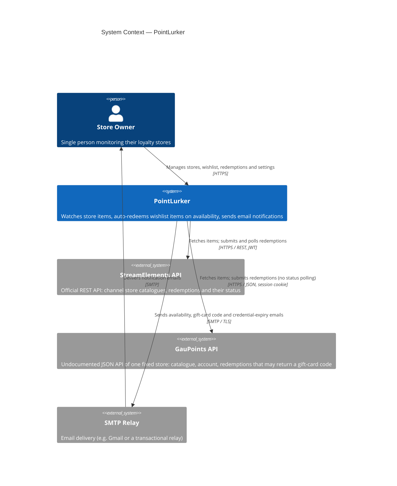
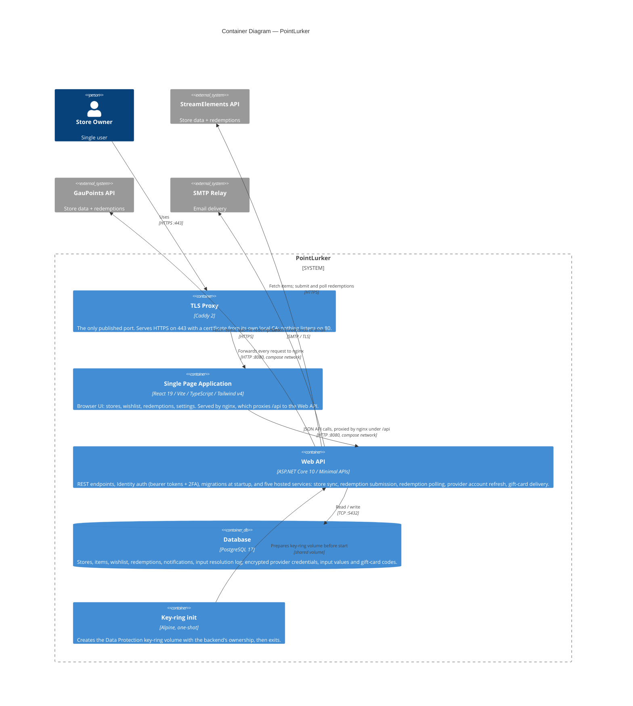
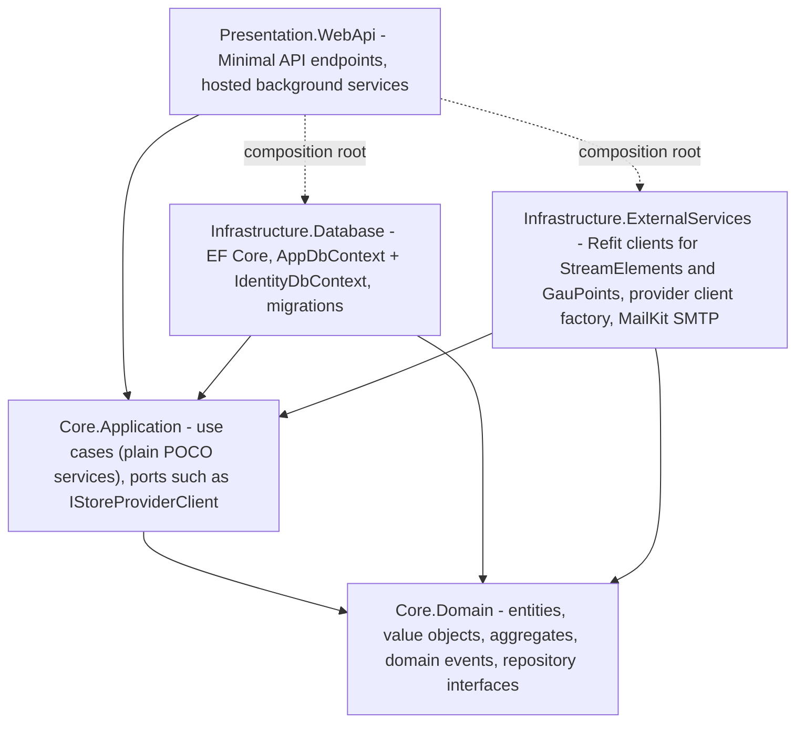
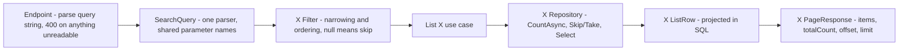

# Architecture

## Objective

Single-user self-hosted web application for monitoring loyalty stores. It watches configured stores on a cron schedule, notifies the owner when wishlisted items become available, and automatically submits redemptions when all required inputs are provided. Two store providers are supported (`StoreProvider`): **StreamElements** (any number of channel stores) and **GauPoints** (one fixed store).

**Core capabilities:**
- Periodic store item sync through each provider's API, behind one `IStoreProviderClient` port
- Wishlist management with per-item notification and auto-redeem flags
- Encrypted storage of provider credentials and redemption inputs (store-level input profile)
- Fuzzy label resolution to map a provider's raw input field names to user-defined canonical names
- Redemption lifecycle tracking (`Pending` → `Submitted` → one of `Completed`, `SubmissionFailed`, `CompletionTimedOut`, `Rejected`)
- Email notifications over SMTP (MailKit): item availability, gift-card codes, and a warning before a provider credential expires

---

## Technical Constraints

| Constraint | Detail |
|---|---|
| Single user | By design — the first `POST /api/auth/register` succeeds; later calls return `400 validation.failed` carrying `users.register_already_exists` (raised by `SingleUserValidator`). See [AUTH.md](AUTH.md). |
| Home server deployment | Docker Compose on a single host. Not designed for multi-node or cloud-native scaling. |
| Provider APIs only | No web scraping. StreamElements data comes from its official REST API ([STREAMELEMENTS-API.md](STREAMELEMENTS-API.md)); GauPoints from its undocumented JSON API ([GAUPOINTS-API.md](GAUPOINTS-API.md)). |
| PostgreSQL 17+ | Only supported database. Two separate EF Core contexts (app + identity). |
| Docker required for some tests | Integration tests (Testcontainers) and the `real` E2E smoke (Docker Compose, with a WireMock StreamElements sidecar and a Mailpit SMTP sink) require a Docker socket. Unit tests and the route-mocked `ui` Playwright project need no Docker. See [BUILD-AND-TEST.md](BUILD-AND-TEST.md). |
| Encrypted secrets at rest | Provider credentials, store input values, the wishlist redemption message and gift-card codes are encrypted via ASP.NET Data Protection. Key ring persisted to a Docker volume. |
| Cron-driven sync | Sync frequency controlled by `SYNC__FETCHCRONEXPRESSION` — neither provider offers webhooks. GauPoints is fetched at most every five minutes whatever the cron says. |

---

## Quality Attributes

| Attribute | How it is addressed |
|---|---|
| **Security** | ASP.NET Identity (bearer tokens + 2FA/TOTP), single-user authorization (authenticated == authorized, no roles), encrypted provider credentials and user inputs, HTTPS-only stack, non-root Docker users, Snyk SAST/SCA/container scans and gitleaks secret scanning in CI. |
| **Correctness** | Rich domain model with invariants enforced in entities, `Result<T,E>` for explicit error paths, state machine for the Redemption lifecycle, domain events for availability transitions. |
| **Reliability** | Durable retry scheduling for failed redemptions, no transport retry on a redeem, outbox delivery for gift-card codes, overlap prevention in store sync (`Interlocked.CompareExchange`; the other jobs run sequential loops), startup recovery for `Pending` redemptions, health checks on all containers. |
| **Maintainability** | Clean Architecture layer separation, TDD, warnings-as-errors, CSharpier enforced in CI, no suppressed warnings or empty catch blocks (Slopwatch). |
| **Testability** | Domain layer has zero infrastructure dependencies. Per-layer unit tests, architecture tests (NetArchTest), per-provider contract tests over recorded fixtures plus a weekly live probe, integration tests over real PostgreSQL (Testcontainers), and Playwright `ui` + `real` projects. See [BUILD-AND-TEST.md](BUILD-AND-TEST.md). |
| **Performance** | EF Core `NoTracking` by default, parallel store fetches, `System.Threading.Channels` wake-ups, no N+1 queries. |
| **Observability** | Structured logging via `ILogger<T>` with `LoggerMessage` source generation, `/health` endpoint, sync cycle results logged on each run. |

---

## C4 Level 1 — System Context

---

## C4 Level 2 — Containers

### Web API — internal layer structure

Dependency rule: inner layers have zero references to outer layers. Infrastructure and Presentation depend on Core; Core has no outward dependencies. Presentation references Infrastructure only to register it. Enforced by `Architecture.Tests`.

---

## Design Decisions

### Clean Architecture over feature-sliced or CRUD

The domain has real business rules (availability, redemption state machine, input coverage) that benefit from isolation in `Core.Domain`, testable without any infrastructure.

### No MediatR — plain POCO services

Use cases are `sealed` classes with one `ExecuteAsync`, registered and injected by concrete type. No cross-cutting pipeline justifies the indirection.

### Result\<TValue, TError\> over exceptions

Endpoint-facing use cases return `Result<TValue, TError>`; exceptions are for unexpected failures. Background use cases (`SyncStores`, `StoreSyncUnit`, `SubmitRedemptions`, `PollRedemptionStatus`, `RefreshProviderAccounts`, `RefreshStoreChannelInfo`, `WarnExpiringCredentials`, `DeliverFulfillmentCodes`) have no HTTP response to shape and return their own records or a bare `Task`.

### Domain events for side effects

`StoreItem.UpdateFromApi` raises availability events instead of acting inline; `SyncStores` processes them after the fetch phase. See [DOMAIN-MODEL.md](DOMAIN-MODEL.md#domain-events).

### Constructor injection, not the container

Nothing in `Core.Application` resolves a service at call time. Where a fresh scope per item is needed (parallel per-store sync), the use case takes a `Func<ScopedInstance<T>>`. Enforced by `Architecture.Tests/ApplicationConventionTests`.

### Store providers behind one port

Use cases see `IStoreProviderClient`, picked per `StoreProvider` by `IStoreProviderClientFactory` (keyed DI). Each client declares its differences as `StoreProviderCapabilities` — GauPoints has one store, no redemption polling, no messages, returns gift-card codes and a five-minute minimum sync interval — so use cases branch on capabilities, never on the provider. The wire is declared with Refit (`IStreamElementsApi`, `IGauPointsApi`), and each provider's quirks are classified inside its own client. See [STREAMELEMENTS-API.md](STREAMELEMENTS-API.md) and [GAUPOINTS-API.md](GAUPOINTS-API.md).

### System.Threading.Channels for background wake-ups

`Channel<Redemption>`, `Channel<UsernameRefreshSignal>` and `Channel<FulfillmentCodeReady>` are **wake-up signals, not work queues**: consumers discard what they read and re-read pending rows from the database, so work survives a restart. Producers publish only after commit.

### Gift-card codes: persisted first, delivered by an outbox

A provider returns a gift-card code once, so `SubmitRedemptions` commits the encrypted `FulfillmentCode` in the same unit of work as the redemption's outcome. `DeliverFulfillmentCodes` mails it from its own hosted service, retrying forever with backoff, so a stalled SMTP server never delays redemptions. See [DOMAIN-MODEL.md](DOMAIN-MODEL.md#fulfillmentcode) and [DEPLOYMENT.md](DEPLOYMENT.md#data-persistence).

### Credential expiry warnings: once per expiry

A GauPoints session lives seven days and only a human can mint a new one. Each provider-account refresh pass runs `WarnExpiringCredentials`, which emails once per expiry inside `CREDENTIALS__EXPIRYWARNINGHOURS` and records it in `ExpiryWarningSentFor`. See [CONFIGURATION.md](CONFIGURATION.md) and [DOMAIN-MODEL.md](DOMAIN-MODEL.md#providercredential).

### Two DbContexts

`AppDbContext` holds application tables; `IdentityDbContext` holds the ASP.NET Identity tables plus `ProviderCredentials`. Keeps the Identity schema and its configuration apart.

### Persistence: NoTracking, deltas, unit of work

- `AppDbContext` is globally `NoTracking`. A read returning tracked entities is named `…ForUpdateAsync` and is the only one calling `AsTracking()`; nothing calls `AsNoTracking()`. List views project to read-model rows in SQL.
- Writes persist change-tracker deltas — no `DbSet.Update`. A write must use an entity loaded by `…ForUpdateAsync` in the same DI scope; `Update` throws on a detached one. The `jsonb` list columns rely on their `ValueComparer` (`JsonListComparer`) for delta detection.
- Repositories stage synchronously; the use case commits once via `IUnitOfWork.SaveChangesAsync`. The only exception is `PruneAsync` (`ExecuteDeleteAsync`).
- Commits are split only for external reasons: **per store** in a sync cycle (one failing store cannot roll back the rest) and **per redemption** in submission (the provider call already happened). A redeem is never retried by the HTTP resilience handler (`DisableForUnsafeHttpMethods`); the use case's counted, durable retry is the only one.

Enforced by `Architecture.Tests/InfrastructureConventionTests`.

### ASP.NET Data Protection for encryption

Each secret kind has its own purpose (`ProtectionPurposes`; provider credentials picked by `ProviderSecretProtectors`), and a shipped purpose string never changes. The key ring is backup-critical because gift-card codes cannot be re-entered. See [CONFIGURATION.md](CONFIGURATION.md#data-protection) and [DEPLOYMENT.md](DEPLOYMENT.md#data-persistence).

### Cronos for scheduling

Store sync, redemption polling and provider account refresh evaluate cron expressions at runtime, so operators change frequency via environment variables. See [CONFIGURATION.md](CONFIGURATION.md).

### FuzzySharp for label resolution

Raw input labels resolve to canonical ones by alias, then exact match, then FuzzySharp `TokenSetRatio` above `INPUTRESOLUTION__MATCHTHRESHOLD`. `GET /api/stores/{id}/profile` returns the live picture. See [GLOSSARY.md](GLOSSARY.md#input-resolution).

### Minimal APIs (no controllers)

Endpoints are small groups: `MapIdentityApi` under `/api/auth`, `AuthEndpoints`, `UserEndpoints` (including provider credentials), `StoreEndpoints`, `StoreLookupEndpoints`, `WishlistEndpoints`, `RedemptionEndpoints`.

### React Context over Redux/Zustand

Auth is the only global state; `AuthProvider` + `useAuth()` cover it. Each feature fetches its own data via hooks.

### Radix UI over a full component library

Radix provides unstyled, accessible primitives (Dialog, Switch, Toast); Tailwind v4 does all styling. See [DESIGN.md](DESIGN.md).

### Search lives in the backend

Filtering, sorting, faceting and paging are the database's job on every list surface; the frontend only turns URL parameters into a query string.

- **One envelope everywhere**, enforced by an architecture test. Aggregates that do not vary with the filter are separate endpoints (`GET /api/stores/{id}/items/facets`, `GET /api/stores/summary`).
- **Parameter names are the browser's** (`q`, `avail`, `sort`, `dir`, …; see `Presentation.WebApi/Search/SearchParameters.cs`), so one serializer builds both the URL and the API query.
- **Item search is full-text in PostgreSQL**: word matching over name and description, substring over the name, and near-miss over the name, OR-ed together (`StoreItemRepository.MatchTerm`). The `item_search` configuration is `simple` + `unaccent`, because item text mixes languages within one row. With a term, the default `sort=relevance` ranks name matches first, then `ts_rank`. The wishlist reuses the name arms (`StoreItemTextMatch.ByName`).
- The `item_search` configuration and `IX_store_items_Search` are raw SQL, absent from the model snapshot; `IntegrationTests/Migrations/FullTextItemSearchMigrationTests` guards them.
- **Unrecognized values are refused**, never defaulted — see [ERROR-CODES.md](ERROR-CODES.md#namespace-search).
- Stock `-1` (unlimited) sorts as largest, and every ordering ends with an `Id` tiebreaker so offset paging is stable. Availability is single-sourced as `StoreItem.IsAvailableExpression`.

### RFC 7807 ProblemDetails with stable error codes

Every 4xx/5xx is `application/problem+json` with a stable `code` (`ErrorCodes.*`) and `params`; `title` is English and developer-facing. See [ERROR-CODES.md](ERROR-CODES.md).

### Localization on the frontend

The backend returns no localized strings over HTTP and localizes only emails. See [I18N.md](I18N.md#data-flow).
