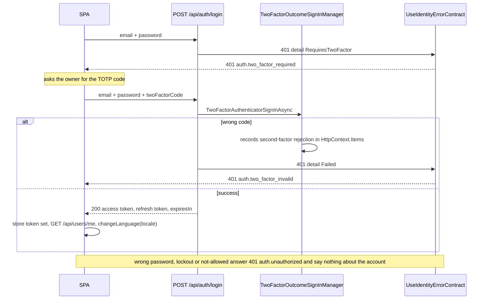
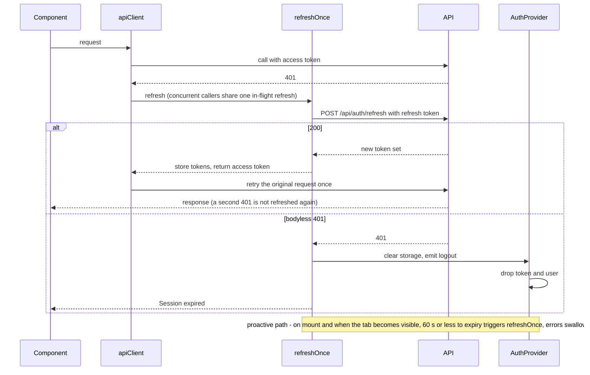

# Authentication & Authorization

Single-user application. Authentication is served almost entirely by the framework **ASP.NET Identity API** (`MapIdentityApi<ApplicationUser>()`), using its opaque bearer tokens — not JWTs. Reference: [Identity API authorization](https://learn.microsoft.com/en-us/aspnet/core/security/authentication/identity-api-authorization?view=aspnetcore-10.0).

The custom auth code is exactly this list; anything beyond it needs a reason to exist:

- **First-run gate** — `GET /api/auth/bootstrap` (`Endpoints/Auth/AuthEndpoints.cs`).
- **Single-user validator** — `SingleUserValidator` (`Auth/`).
- **Endpoint suppression** — `UseSuppressedIdentityEndpoints` (`Auth/SuppressedIdentityEndpoints.cs`).
- **Options** — `AuthTokenOptions` (token lifetimes) and `IdentityPolicyOptions` (lockout, password length), both bound from the `Authentication` section and validated on startup.
- **Two-factor outcome** — `TwoFactorOutcomeSignInManager`, which records whether a rejected login failed on its second factor.
- **Error contract** — `UseIdentityErrorContract` (`Auth/IdentityErrorContract.cs`) plus `IdentityErrorMapper` (`Errors/`), which maps Identity's codes to catalog codes.
- **Claims helper** — `CurrentUserClaims` (`ClaimsPrincipal.GetUserId()`).

Paths are relative to `backend/src/Presentation.WebApi/`. CORS lives in `Cors/` and is not auth code.

---

## Model

- **Single user.** Exactly one `ApplicationUser` may ever exist. The first `POST /api/auth/register` succeeds; every later one returns `400 validation.failed` carrying `users.register_already_exists` in `params.errors[]`. Enforced at the Identity core by `SingleUserValidator : IUserValidator<ApplicationUser>` (Identity code `SingleUserOnly`, mapped by `IdentityErrorMapper`), **not** an endpoint guard. See [ERROR-CODES.md](ERROR-CODES.md#namespace-users).
- **No roles.** Authenticated == authorized. Protected endpoints use `RequireAuthorization()`; there is no role or policy check.
- **Provider credentials at rest.** One `ProviderCredential` per `(UserId, Provider)`: the StreamElements JWT (treated as opaque) and the GauPoints `kp_session` cookie (its `exp` read as an expiry hint by `DescribeCredential`, never verified). Each provider's secret is encrypted with ASP.NET Data Protection under its own purpose (`ProviderSecretProtectors`), and use cases read it only through `ProviderSecrets`. The owner is emailed before a credential expires — see [CONFIGURATION.md → Provider credentials](CONFIGURATION.md#provider-credentials); key-ring storage is in [CONFIGURATION.md → Data Protection](CONFIGURATION.md#data-protection).
- **CORS.** Off by default: nginx proxies `/api`, so the shipped stack is same-origin. No policy ever uses `AllowCredentials`, because auth rides in the `Authorization` header, not cookies. See [CONFIGURATION.md → CORS](CONFIGURATION.md#cors).

---

## Endpoints

### Identity API — `/api/auth`

Provided by `MapIdentityApi`. Exposed: `register`, `login`, `refresh`, `manage/2fa`, and `POST manage/info` (email/password change).

These framework endpoints follow the app-wide RFC 7807 `{code, params}` contract. `UseIdentityErrorContract` buffers their 4xx `application/problem+json` bodies and **adds** `code` and `params` — nothing the framework wrote is removed. Validation failures become `validation.failed` via `IdentityErrorMapper`; sign-in failures get the codes shown in [Login with two-factor](#login-with-two-factor). Every code is catalogued in [ERROR-CODES.md](ERROR-CODES.md#namespace-auth).

**Suppressed (`404`).** `MapIdentityApi` has no per-endpoint opt-out, so `UseSuppressedIdentityEndpoints` runs as terminal middleware and **must run before endpoint binding** (an endpoint filter is too late — some suppressed endpoints throw during body binding). It suppresses:

- `forgotPassword`, `resetPassword`, `confirmEmail`, `resendConfirmationEmail` (any method)
- `GET manage/info` only — `POST manage/info` stays reachable

> Two-factor *state* is read from `GET /api/users/me`. `POST manage/2fa` returns — and, for an account without one, mints — the TOTP shared key, so a page must not call it just to render a toggle.

### First-run gate — `/api/auth/bootstrap`

`GET /api/auth/bootstrap` — anonymous, pre-session. Returns `{ userExists: bool }` so the frontend can send a fresh install to registration. It is the only custom endpoint under `/api/auth`.

### Current-user resource — `/api/users/me`

All under `RequireAuthorization()`:

| Method | Route | Purpose |
|---|---|---|
| `GET` | `/api/users/me` | `userId`, `email`, `locale`, `twoFactorEnabled`, and `credentials[]` — per stored credential its `provider` slug, `accountName`, `expiresAt`, `lastValidatedAt` and `lastValidationError` code. Never the secret. |
| `PATCH` | `/api/users/me/locale` | Set the UI locale (validated against `SupportedLocales`; `400 users.locale_unsupported` otherwise). |
| `PUT` | `/api/users/me/credentials/{provider}` | Store or replace a provider's credential (`streamelements`, `gaupoints`), body `{ "secret": "…" }`. See below. |
| `DELETE` | `/api/users/me/credentials/{provider}` | Clear a provider's credential. Idempotent. |

Storing a credential checks it first:

- A credential whose announced expiry has already passed is refused with `422 credentials.expired`, before any provider call.
- A `401`/`403` from the provider is refused with `422 credentials.rejected`; nothing is stored.
- Any other provider failure gives no verdict: the credential is stored unconfirmed, and the next account-refresh pass checks it.

The secret is never echoed — not in a response, a log, a validation failure's params, or `LastValidationError`. Codes: [ERROR-CODES.md](ERROR-CODES.md#namespace-credentials).

#### Resolving the current user

Handlers never call `UserManager.GetUserAsync(principal)` — an architecture test forbids it under `Endpoints/`.

| Handler needs | Mechanism | Used by |
|---|---|---|
| Owner id only | `ClaimsPrincipal.GetUserId()` — no database round-trip | `GET /api/stores`, `GET /api/stores/summary`, `POST`/`GET /api/wishlist` |
| Owner entity | `ISingleUserProvider` — safe because exactly one user exists | `GET /api/users/me`, `POST /api/stores`, and use cases that resolve the owner themselves (locale, credentials, background jobs) |

**`401` belongs to the authorization middleware**, so handlers carry no `401` branch. A missing owner row is `404 users.not_found`. An authenticated principal with no parsable `NameIdentifier` claim is a server misconfiguration and returns `500 system.internal_error` — a `401` there would trigger the frontend's refresh-and-retry and end in a logout the user could not fix.

---

## Tokens (app session)

Access and refresh lifetimes are configurable, validated on startup, and access must be strictly shorter than refresh — see [CONFIGURATION.md → Authentication](CONFIGURATION.md#authentication). The frontend stores `{ accessToken, refreshToken, expiresAt }` in `localStorage` under `pl.auth.token` (`features/auth/authStorage.ts`).

### Login with two-factor

Login is a raw `fetch` (`features/auth/authApi.ts`) so a failed sign-in never triggers the refresh-on-401 path.

`detail` reads `Failed` for both a wrong password and a wrong second factor, and the endpoint tries the second factor only after accepting the password, so neither the response nor the request can tell them apart. `TwoFactorOutcomeSignInManager` records the attempt it actually made, and the contract middleware reads it back.

### Token refresh

A dead refresh token is a bodyless `401` challenge — there is no document to add a code to, and the client's only move is to drop the session.
