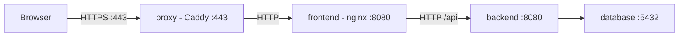

# Deployment

Deployment target: single-host home server running Docker Compose, pulling pre-built multi-arch images (amd64 + arm64) from the GitHub Container Registry.

---

## Docker Images

| Image | Registry |
|---|---|
| `ghcr.io/luanholiv/pointlurker-backend` | GHCR (public) |
| `ghcr.io/luanholiv/pointlurker-frontend` | GHCR (public) |

Tags per release: `latest` + `v{major}.{minor}.{patch}` (e.g. `v1.2.3`), resolving to the same digest. Both containers listen on `8080` (the frontend's nginx runs unprivileged as `USER 101`), and neither is published on the host — see [HTTPS](#https). The frontend bundle is origin-relative, so a deployment sets no `VITE_API_URL` and no CORS.

### Image Provenance

Release images are signed with [cosign](https://github.com/sigstore/cosign) (keyless, via GitHub Actions OIDC), and an SPDX SBOM is attached to each image and to every [GitHub Release](https://github.com/luanholiv/pointlurker/releases).

Verify a pulled image ([install cosign](https://docs.sigstore.dev/cosign/system_config/installation/)):

```bash
cosign verify \
  --certificate-identity "https://github.com/luanholiv/pointlurker/.github/workflows/cd.yml@refs/heads/main" \
  --certificate-oidc-issuer "https://token.actions.githubusercontent.com" \
  ghcr.io/luanholiv/pointlurker-backend:v1.2.3
```

Replace `v1.2.3` with your version and swap the image name for the frontend. For the SBOM, use `verify-attestation --type spdxjson` or download it from the GitHub Release.

- **Only signed digests are tagged.** `v{version}` and `latest` are published after the container scan (`snyk container test --severity-threshold=high`) passes and the digest is signed. The backend's `v{version}-amd64`/`-arm64` tags are unsigned build intermediates; verify `v{version}` or `latest`.
- **A draft GitHub Release means CD did not finish.** semantic-release creates it as a draft, and CD publishes it in its last step.
- **Builds are not bit-reproducible.** Images install packages from the live Alpine index, so a later rebuild of the same commit can differ; the signature and SBOM describe the published digest.

**Re-driving a failed release.** If a scan, signing or promotion failed after the images were pushed, run **Actions → CD → Run workflow** with the `version` (no leading `v`) and `skip_build` checked: it re-scans the registry images and re-runs signing and the `latest` promotion without rebuilding. Pipeline details: [CI-CD.md](CI-CD.md).

Repository secrets: `SNYK_TOKEN` (CD) and `CODECOV_TOKEN` (CI). Images are pushed with the workflow's own `GITHUB_TOKEN`.

---

## Self-Hosted Deployment

Each GitHub Release attaches the current `docker-compose.yml` and `.env.example`; use those files on the target host.

### First-time setup

```bash
# 1. Create your .env from the template, then fill in the required values
cp .env.example .env

# 2. Start
docker compose up -d
```

### Updating to a new release

```bash
docker compose pull
docker compose up -d
```

Containers are replaced in place; PostgreSQL data persists in the `postgres_data` volume.

### HTTPS

The stack is **HTTPS only**. A Caddy `proxy` service terminates TLS and is the only published port: `443` (TCP, plus UDP for HTTP/3). Nothing listens on `80`, so `http://` is refused rather than redirected and no credential ever crosses the network in clear.



Every hop after `proxy` stays on the compose network.

Point `PUBLIC_HOST` (default `homelab.local`) at the server's LAN address through your router's DNS or each device's hosts file, and set [`APP__PUBLICBASEURL`](CONFIGURATION.md#console-url) to `https://` plus the same name so emails link back. The Caddy configuration is inline in `docker-compose.yml`, because each release ships only `docker-compose.yml` and `.env.example` and a separate Caddyfile would never reach a self-hosted install. A change to it or to `PUBLIC_HOST` needs:

```bash
docker compose up -d --force-recreate proxy
```

#### Why a local CA, not Let's Encrypt

No public CA issues for `.local`, which is reserved for multicast DNS. Caddy runs its own CA (`tls internal`): it creates a root (valid 10 years) and an intermediate, and issues and renews the site certificate itself. Browsers trust it once the **root** is installed on the device.

#### Trusting the root certificate

Export it once from the running proxy:

```bash
docker compose cp proxy:/data/caddy/pki/authorities/local/root.crt ./local-root.crt
```

Then install it on every device that opens the app:

| Platform | How |
|---|---|
| Windows | Double-click the file → **Install Certificate** → Local Machine → *Trusted Root Certification Authorities*. Or `certutil -addstore -f Root local-root.crt` (admin). |
| macOS | `sudo security add-trusted-cert -d -r trustRoot -k /Library/Keychains/System.keychain local-root.crt` |
| Linux (Debian/Ubuntu) | `sudo cp local-root.crt /usr/local/share/ca-certificates/ && sudo update-ca-certificates` |
| Firefox (any OS) | Uses its own store: **Settings → Privacy & Security → Certificates → View Certificates → Authorities → Import**, tick *Trust this CA to identify websites*. |
| Android | **Settings → Security → Encryption & credentials → Install a certificate → CA certificate**. |
| iOS / iPadOS | Open the file to install the profile (**Settings → General → VPN & Device Management**), then enable it under **Settings → General → About → Certificate Trust Settings** — the second step is easy to miss. |

Until then the browser shows a certificate warning. HSTS is deliberately not sent: with nothing on `80` there is no downgrade to prevent, and it would turn that warning into a hard failure.

**Back up `caddy_data`.** It holds the root's private key; losing it means every device must trust a new root.

#### Administration without published ports

```bash
docker compose exec database psql -U api PointLurker   # use your POSTGRES_* values
docker compose exec backend wget -qO- http://localhost:8080/health
```

#### Using a real domain instead

Point a name you own (e.g. `monitor.example.com`) at the server, set `PUBLIC_HOST` to it, and replace `tls internal` with Caddy's ACME support (DNS-01 for a host not reachable from the internet). That gives a publicly trusted certificate and removes the per-device trust step.

### Environment variables

Set them in a `.env` beside `docker-compose.yml` (copy [`.env.example`](../.env.example)) or as host environment variables. Every variable, default and constraint: [CONFIGURATION.md](CONFIGURATION.md). For a deployment:

- The four `SMTP__*` credentials (`HOST`, `USERNAME`, `PASSWORD`, `FROM`) are **required**; the backend refuses to start without them.
- `IMAGE_TAG` (default `latest`) pins the image version — see [Rollback](#rollback).
- `POSTGRES_USER`/`POSTGRES_PASSWORD`/`POSTGRES_DB` feed both the database and the backend connection string; set them once.

### Email / SMTP

Any SMTP provider works. Two examples:

**Gmail:**

1. Enable **2-Step Verification** on the Google account (required for App Passwords).
2. Go to **Google Account → Security → App passwords** and generate a 16-character password.
3. Set:
   ```
   SMTP__HOST=smtp.gmail.com
   SMTP__PORT=587
   SMTP__SECURITY=StartTls
   SMTP__USERNAME=you@gmail.com
   SMTP__PASSWORD=<16-char App Password>   # NOT your normal account password
   SMTP__FROM=you@gmail.com
   ```
   `SMTP__FROM` must be the Gmail address or a verified "Send mail as" alias, or Gmail rewrites or rejects it.

**Any other relay** (your own mailbox, a corporate relay, Brevo/Mailjet): point the same variables at it. `SMTP__FROM` is usually a verified sender on that account.

```
SMTP__HOST=smtp-relay.example.com
SMTP__PORT=587
SMTP__SECURITY=StartTls
SMTP__USERNAME=<relay user / API key>
SMTP__PASSWORD=<relay password / API secret>
SMTP__FROM=notifications@yourdomain.com
```

### Data persistence

| Volume | Contents |
|---|---|
| `postgres_data` | All application data (PostgreSQL) |
| `dataprotection_keys` | ASP.NET Data Protection key ring (encrypts provider credentials, user inputs and gift-card codes) |
| `caddy_data` | The proxy's local root CA and issued certificates |
| `caddy_config` | Caddy's autosaved runtime configuration (regenerated on start) |

**The key ring is backup-critical.** Losing `dataprotection_keys` makes every encrypted value unreadable. A credential or input can be re-entered, but a gift-card code cannot: a provider returns it once, and no endpoint reveals it again. Keep the volume on persistent storage and back it up **together with** `postgres_data` — a database backup without its key ring holds codes nothing can decrypt. Key rotation is safe (expired keys stay in the ring for decryption); only losing the ring is fatal.

A one-shot `dataprotection-init` container runs before the backend on every `up`, giving the key-ring directory to UID `1000` (the backend's non-root user), then exits.

### Health checks

Compose waits for these before starting dependent services; `dataprotection-init` is gated on exiting successfully instead.

| Container | Check | Interval | Retries | Start period |
|---|---|---|---|---|
| `database` | `pg_isready` | 10s | 3 | 10s |
| `backend` | `GET /health` | 10s | 5 | 15s |
| `frontend` | `GET /health` | 5s | 3 | 5s |
| `proxy` | `GET :2019/config/` (Caddy admin API, container-local) | 10s | 3 | 5s |

---

## Rollback

Pin `IMAGE_TAG` in the host's `.env` and redeploy:

```bash
# On the host
echo "IMAGE_TAG=v1.1.0" >> .env
docker compose pull
docker compose up -d
```

Migrations are forward-only. If the older version cannot run against the current schema, restore a database backup taken before the upgrade.
