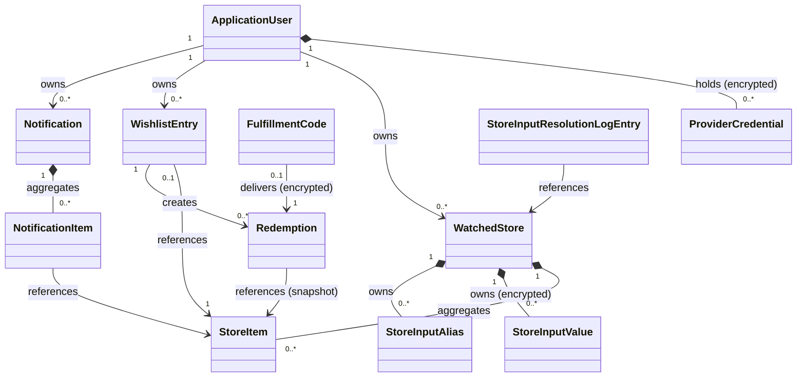
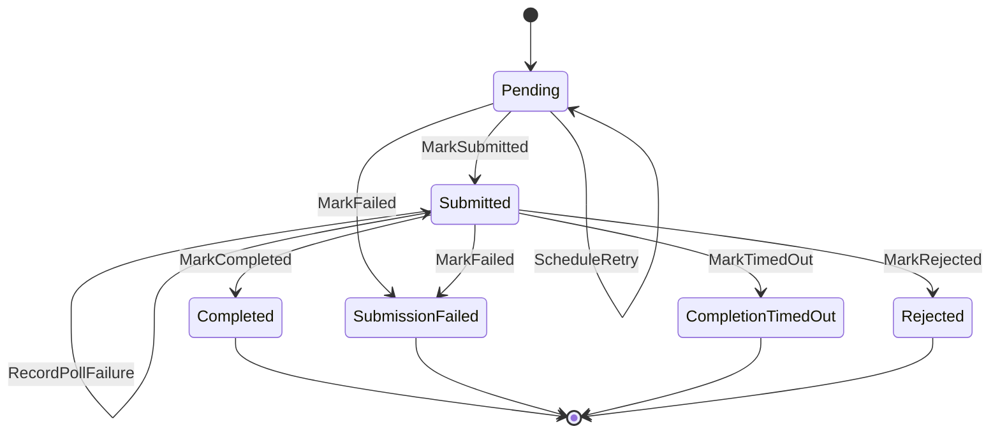
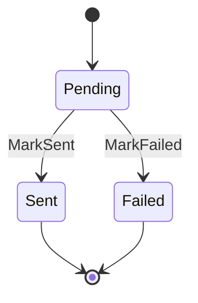
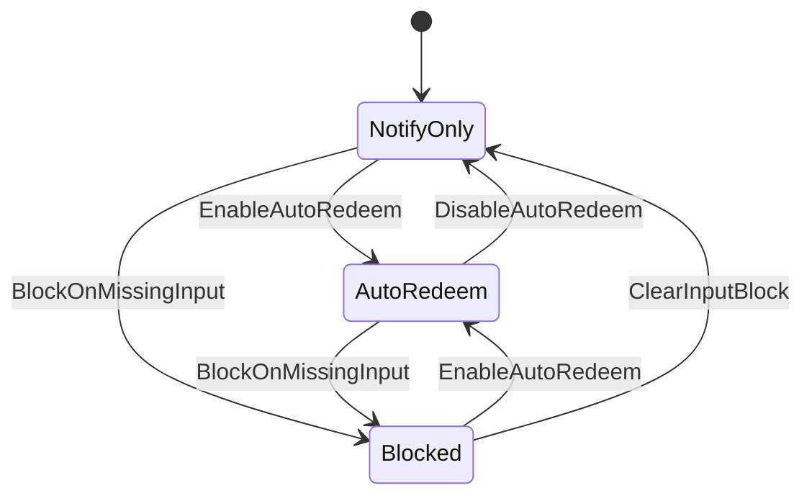

# Domain Model

Structural reference for `Core.Domain`. Covers aggregate boundaries, relationships, state machines, invariants, and domain events. For per-entity property and method definitions, **read the entity source files** under `backend/src/Core.Domain/` — this document deliberately does not mirror them. For term definitions across all layers see [GLOSSARY.md](GLOSSARY.md).

---

## Aggregates & Relationships

`StoreInputValue` and `StoreInputAlias` are records stored as `jsonb` columns on `watched_stores`, not entities with their own table. Most arrows are logical references, not foreign keys: users live in the Identity context, and `Redemption` and `NotificationItem` hold bare `StoreItem` ids. Deleting a store cascades to its items and wishlist entries; redemptions survive it.

Per-entity definitions live in [GLOSSARY.md](GLOSSARY.md); members live in the source files. Lifecycle rules (single-user, append-only, inputs-resolved-at-submission) are in [Key Invariants](#key-invariants) below.

---

## State Machines

Lifecycles driven by entity methods. The plain value enums are code mappings, not state machines: `SubmissionFailureCode` is documented in [ERROR-CODES.md](ERROR-CODES.md), and `NotificationChannel` and `ResolutionSource` in [GLOSSARY.md](GLOSSARY.md).

### Redemption (`RedemptionStatus`)

Transitions enforced by the labelled entity methods — no direct property assignment. `ScheduleRetry` is a self-loop (stays `Pending`); it and `MarkSubmitted` each increment `Attempts`; the four states pointing to `[*]` are terminal. On `MarkFailed` the typed `FailureCode` is set — see [ERROR-CODES.md](ERROR-CODES.md).

Polling runs only for a provider whose client declares `SupportsRedemptionPolling` (StreamElements today): a GauPoints redeem that succeeds goes `Pending → Submitted → Completed` in one pass, so `Rejected`, `RecordPollFailure` and `ClearPollFailures` never apply to it. `MarkTimedOut` applies to any provider.

`Rejected` is the provider accepting the submission and then refusing to fulfil it (StreamElements reports `rejected` on its redemption lookup). `SettledAt` holds the provider's settle time for both `Completed` and `Rejected`. It is distinct from `CompletionTimedOut`: the outcome is known rather than missing.

`RecordPollFailure` is the second self-loop, and deliberately **not** a status change. It counts consecutive failed readings of the completion status in `PollFailures` and keeps the last reason in `LastPollError`. A failing status check says nothing about whether the submission worked, so reopening the redemption would let auto-redeem submit a second one and spend the owner's points again for an item that may already be redeemed upstream. `ClearPollFailures` resets the pair once a reading gets through.

### Notification (`NotificationStatus`)

Diagram shows the intended lifecycle. Unlike `Redemption`, the entity does **not** guard transitions — `MarkSent` / `MarkFailed` may be called from any state (`MarkSent` clears a prior `FailureReason`).

### WishlistEntry auto-redeem / input block

States are the `(AutoRedeem, IsBlockedOnInput)` flag pair: `NotifyOnly (F,F)` · `AutoRedeem (T,F)` · `Blocked (F,T)`. `(T,T)` is unreachable — the flags are mutually exclusive. Enable/Disable are user-driven (entry creation and wishlist settings). Block/Clear are sync-driven: `StoreInputCoverageUnit`, run per store by `StoreSyncUnit`, blocks only entries with `AutoRedeem` on — so `NotifyOnly → Blocked` is allowed by the entity but never taken — and calls `ClearInputBlock` when coverage returns or the item drops all input definitions. Note the asymmetry: `ClearInputBlock` returns to `NotifyOnly`, **not** `AutoRedeem` — auto-redeem must be re-enabled explicitly.

---

## Domain Events

Raised inside entities during state transitions. Stored in `_domainEvents`; `StoreSyncUnit.HarvestEvents` maps `StoreItemBecameAvailable` and clears the list. Nothing consumes `StoreItemBecameUnavailable`, and items created by `AddWatchedStore` are never harvested. All implement `IDomainEvent { DateTimeOffset OccurredAt }`.

| Event | Raised by | Condition |
|---|---|---|
| `StoreItemBecameAvailable` | `StoreItem` constructor **and** `UpdateFromApi()` | New availability is `true` (from unavailable, or on creation of an available item) |
| `StoreItemBecameUnavailable` | `StoreItem.UpdateFromApi()` **and** `MarkUnavailable()` | Availability goes `true` → `false` |

> **Defined but not raised.** The record types `WishlistEntryBlockedOnInput` and `WishlistEntryInputCoverageRestored` exist in `Core.Domain` but are **never instantiated** — `WishlistEntry` holds no domain-event list. Instead, `StoreInputCoverageUnit` returns an application-layer `BlockedEvent`, which `SyncStores` records as a `WebUi` `Notification`; coverage restored is only logged.

---

## Key Invariants

### ApplicationUser
- Only one instance may exist in the system — enforced by `SingleUserValidator` in Presentation, not in `Core.Domain`.
- Holds no provider secret: those are `ProviderCredential`s.
- `Locale` cannot be blank and defaults to `SupportedLocales.EnUs`. The allowlist (`SupportedLocales.All`) is checked by `PATCH /api/users/me/locale` and the `CK_AspNetUsers_Locale_Allowlist` database constraint, not the entity.

### ProviderCredential
- At most one per `(UserId, Provider)` — the composite key. Lives on the Identity context, beside
  the user it belongs to, and commits with it.
- `EncryptedSecret` is Data Protection ciphertext and is never blank; the plain secret never
  reaches the entity.
- `ReplaceSecret` forgets the old secret's validation (`LastValidatedAt`, `LastValidationError`)
  but keeps `AccountName` until a lookup replaces it. A failed lookup never clears `AccountName`.
- `LastValidationError` holds an error code only, never provider text, which could echo the secret.
- `ExpiresAt` is the expiry the secret announces about itself — a GauPoints session is a JWT
  whose `exp` is read, never verified — and null for an opaque secret. `ReplaceSecret` clears it.
  It is a lower bound on validity only: `IsExpiredAt` lets callers fail early, but an unexpired
  secret can still have been ended upstream.
- `ExpiryWarningSentFor` is the `ExpiresAt` the owner was last warned about. `NeedsExpiryWarning`
  is true while the current expiry is inside the warning window (or already past) and differs from
  it; `MarkExpiryWarningSent` copies the current expiry in and refuses a credential with none.
  `ReplaceSecret` leaves it alone, so a new session re-arms the warning and the same session pasted
  again does not repeat it.

### WatchedStore
- `DisplayName` cannot be empty.
- At most one `WatchedStore` per `(UserId, Provider, ExternalId)`.
- `Provider` and `ExternalId` are immutable after creation. A `StoreItem` and a `Redemption` carry the same `Provider`; a redemption snapshots it, so it outlives the store.

### StoreItem
- Availability is computed, never a stored flag (`ItemAvailability.From`): `IsAvailable = Enabled AND (Quantity.Current == -1 OR Quantity.Current > 0)`. `Quantity.Current == -1` (unlimited) **must** count as available.

### WishlistEntry
- At most one `WishlistEntry` per `(UserId, StoreItemId)`. A new entry defaults to `DesiredRedemptions = 1` and `NotifyOnAvailable = true`.
- `RedemptionMessage` may only be set when `StoreItem.AllowMessages == true`.
- `AutoRedeem` and `IsBlockedOnInput` are mutually exclusive — the `(true, true)` state is unreachable (transitions in [State Machines](#state-machines)).
- `DesiredRedemptions` is `1..WishlistEntry.DesiredRedemptionsMax`, or `null` for unlimited. It bounds how many redemptions the entry may ever hold; `RedemptionQuota.HoldingStatuses` says which states hold one (`Pending`, `Submitted`, `Completed`), so a failed submission releases its slot rather than stranding the entry.
- `CanCreateRedemption` enforces: auto-redeem enabled, quota not met, item available, affordable (`Cost <= availableBalance`), and cooldown elapsed since `LastRedemptionCreatedAt` — the cooldown is `max(UserMs, GlobalMs, MinimumInterval)`; `CategoryMs` is ignored. Separately, auto-redeem skips an entry with a redemption in flight (`RedemptionQuota.InflightStatuses`: `Pending`, `Submitted`). The caller passes a `RedemptionPolicy` carrying the quota already held and a minimum interval that floors the item's own cooldown — the entity reads no repository and knows no provider.
- Meeting the quota does **not** clear `AutoRedeem`. A satisfied entry and one the user switched off are different things, and flipping the flag would make them indistinguishable; the list reports `QuotaUsed` against `DesiredRedemptions` instead.

### Redemption
- Append-only: created only via `WishlistEntry.CreateRedemption()` (never constructed directly); records are added, never deleted.
- Captured at creation and immutable: `WishlistEntryId`, `StoreItemId`, `StoreItemName`, `StoreName`, `Provider`, `StoreExternalId`, `ProviderItemId` and `MessageSnapshot` (ciphertext). Inputs are **not** part of this snapshot — they are resolved at submission time.
- Status transitions are one-way; terminal states (`Completed`, `SubmissionFailed`, `CompletionTimedOut`, `Rejected`) cannot be left. The entity allows `SubmissionFailed` from both `Pending` and `Submitted`; the application only fails a `Pending` one.
- `PollFailures` / `LastPollError` describe how the *completion check* is faring, never how the submission went — they are counted while the status stays `Submitted`, and are separate from `Attempts`, which counts submission tries and scheduled retries.

### FulfillmentCode
- At most one per redemption (unique index on `RedemptionId`), holding the gift-card code as ciphertext only. Created by `SubmitRedemptions` in the same unit of work as the redemption's outcome, so the two commit together.
- `SentAt` is null until delivered. `MarkSent` and `RecordFailedAttempt` both count an attempt and both refuse once the code is delivered, so a code is mailed at most once per row.
- There is no final failure: `RecordFailedAttempt` only reschedules. `LastError` is cut to 512 characters and never holds the code.
- Never deleted — the code cannot be requested again. No navigation from `Redemption`, so no redemption read loads it.

### Notification
- `NotificationItem` snapshots `StoreName` and `ItemName` at creation — immutable thereafter.
- `FailureReason` populated only when `Status == Failed`.
