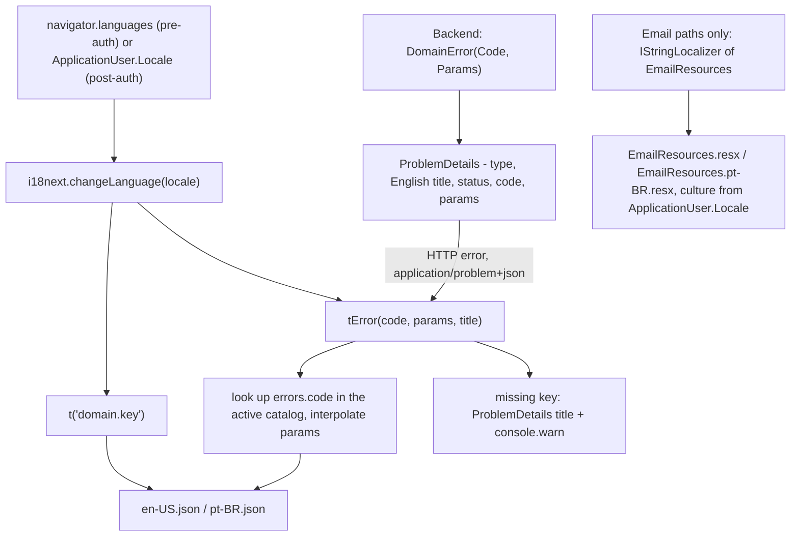

# Internationalization (i18n)

How locales, translations, and localized formatting work across the stack.

**Core rule:** the backend never returns localized strings over HTTP. All user-facing rendering happens on the frontend; the backend localizes **only outbound emails**. See [Data flow](#data-flow) below for the end-to-end picture.

## Data flow



## Supported locales

| Tag | Role |
| --- | --- |
| `en-US` | Default / fallback |
| `pt-BR` | — |

Two allowlists must stay in sync:

- **Backend** — `Core.Domain/Localization/SupportedLocales.cs` (`SupportedLocales.All`). Comparison is **ordinal, case-sensitive** — BCP-47 tags use canonical casing. It does **not** drive the DB `CHECK` constraint on `ApplicationUser.Locale`: `CK_AspNetUsers_Locale_Allowlist` spells the tags out as a literal in hand-written migration SQL, so the two lists are independent and must be widened separately.
- **Frontend** — `frontend/src/i18n/index.ts` (`SUPPORTED_LOCALES`).

Locale resolution:

- **Post-auth:** `ApplicationUser.Locale`, set via `PATCH /api/users/me/locale` (validated against `SupportedLocales`; `400 users.locale_unsupported` otherwise — see [AUTH.md](AUTH.md)).
- **Pre-auth:** `resolveInitialLocale()` exact-matches `navigator.languages` against the allowlist. Matching is exact — `pt-PT` does **not** match `pt-BR`; unmatched falls back to `en-US`.

## Frontend

Layout — `frontend/src/i18n/`:

| File | Purpose |
| --- | --- |
| `index.ts` | `react-i18next` init, locale resolution, `SUPPORTED_LOCALES` / `DEFAULT_LOCALE`. |
| `locales/en-US.json`, `locales/pt-BR.json` | Translation catalogs. UI strings under domain keys; error strings under `errors.*`. |
| `errorCatalog.ts` | `tApiError(err, fallbackKey)` for a `catch` block, `tError(code, params, titleFallback)` when the code is already in hand, and `resolveCode(code, params)` for a single code — the per-field path builds on it. |
| `fieldErrors.ts` | `tApiFieldErrors` resolves every `params.errors[]` entry; `splitFieldErrors` separates the ones anchored to a field from the form-level rest. |
| `fieldLabels.ts` | `resolveFieldLabel` maps a backend field name to its catalog key; `normalizeField` strips collection indexes first. |
| `formatters.ts` | Locale-aware `formatDate` / `formatNumber` / `formatList` / `formatRelativeTime` (native `Intl`, no extra lib). |
| `catalogCompleteness.test.ts` | Fails when leaf keys diverge between catalogs. |
| `deadKeys.test.ts` | Fails when a catalog key is referenced by no component — the inverse blind spot that let the card regression happen. |
| `placeholderParity.test.ts` | Fails when the same key interpolates different `{{placeholders}}` in each catalog — key parity is not message parity. |
| `redemptionStatuses.test.ts` | Fails when the `redemption.status.*` labels and `REDEMPTION_STATUSES` disagree. Those keys are built from a runtime value, so `deadKeys.test.ts` allowlists the prefix and only this can see them; the backend's `Architecture.Tests/RedemptionStatusCatalogTests` closes the other half, against the `RedemptionStatus` enum. |

**UI strings:** use `t("domain.key")` in components — never hardcode user-facing text in JSX. Enforced by `i18next/no-literal-string` over `src/features`, `src/routes` and `src/components` (see the scoped override in `frontend/eslint.config.js`); it runs in `npm run lint`, so it also fires at pre-commit. Decorative glyphs and non-copy attributes are excluded there — extend those lists rather than adding an inline disable.

**Error strings:** in a `catch`, use `tApiError(err, fallbackKey)` — it narrows to `ApiError`, resolves the backend's code through the catalog, and resolves `fallbackKey` for anything else (a dropped connection, a non-`problem+json` response). When the failure carries per-field rules in `params.errors[]`, the first entry's own code wins over the generic outer one, so a password rule reads as the rule rather than as "One or more validation errors occurred." Note `fallbackKey` is a **full** key path, unlike `tError`'s code.

Never render `err.message`: on an `ApiError` it is `title ?? code`, and the ProblemDetails `title` is English developer copy, so it puts English on a pt-BR screen. `no-restricted-syntax` in `frontend/eslint.config.js` rejects `err instanceof Error ? err.message : t(key)` outright — that shape was how ten call sites made the catalog key near-dead.

`tError(code, params, title)` stays for the case where the code is already in hand rather than an exception: it looks up `errors.<code>`, interpolates `params`, and on a missing key returns `titleFallback ?? code` and logs a `console.warn` in DEV. The `code`/`params`/`title` come from the backend RFC 7807 body — see [ERROR-CODES.md](ERROR-CODES.md).

**Formatting:** pass the active locale (`i18n.language`) into the formatter helpers; do not construct `Intl.*` inline. That includes list separators — `formatList` joins with the locale's own conjunction, so never `.join(", ")` user-facing labels. `toLocaleString` / `toLocaleDateString` / `toLocaleTimeString` are banned outright by `no-restricted-syntax` in `frontend/eslint.config.js`: with no argument they follow the *browser* locale rather than the selected one, and with an explicit `"en-US"` they pin it — both shipped in the card components before this was enforced.

## Backend

The backend localizes **only emails**, via `IStringLocalizer<EmailResources>`:

- Resources: `Infrastructure.ExternalServices/Resources/Email/EmailResources.resx` (default) + `EmailResources.pt-BR.resx`.
- Recipient locale is read from `ApplicationUser.Locale`; the render scope switches `CultureInfo` accordingly.
- There is **no `RequestLocalizationMiddleware`** — single-user app, locale comes straight off the user record.

Everything else the backend emits is language-free:

- HTTP errors are RFC 7807 with a stable `code` + `params`; the `title` is always English (developer-facing fallback). Codes come from `ErrorCodes.*` constants only — see [ERROR-CODES.md](ERROR-CODES.md).
- Failure modes are enum codes (`Redemption.FailureCode` → `SubmissionFailureCode`), not English strings. The response carries the matching `redemption.failure.*` code string rather than the stored integer, so the reader resolves it through the catalog instead of keeping its own copy of the enum. `FailureContext` carries non-localizable diagnostic detail.

## Adding a locale

1. Backend: add the tag to `SupportedLocales.cs` (`All` + a `const`). This widens **validation only**.
2. Backend: add an EF migration widening the DB constraint by hand. A scaffold will not generate it — the constraint is raw SQL that repeats the tag list as a literal:

   ```sql
   ALTER TABLE "AspNetUsers" DROP CONSTRAINT "CK_AspNetUsers_Locale_Allowlist";
   ALTER TABLE "AspNetUsers" ADD CONSTRAINT "CK_AspNetUsers_Locale_Allowlist"
       CHECK ("Locale" IN ('en-US', 'pt-BR', '<new-tag>'));
   ```

   Skipping this leaves every write of the new locale failing on a constraint violation at runtime, with validation happily allowing it.
3. Frontend: add the tag to `SUPPORTED_LOCALES` in `index.ts` and register it in the i18next `resources` map.
4. Add a full `locales/<tag>.json` catalog. `catalogCompleteness.test.ts` fails until every leaf key present in `en-US.json` exists (and no extras).
5. Add `EmailResources.<tag>.resx` with every string from the default `.resx`.
6. Add the matching `errors.<code>` keys (covered by step 4 — they live in the same catalog).
